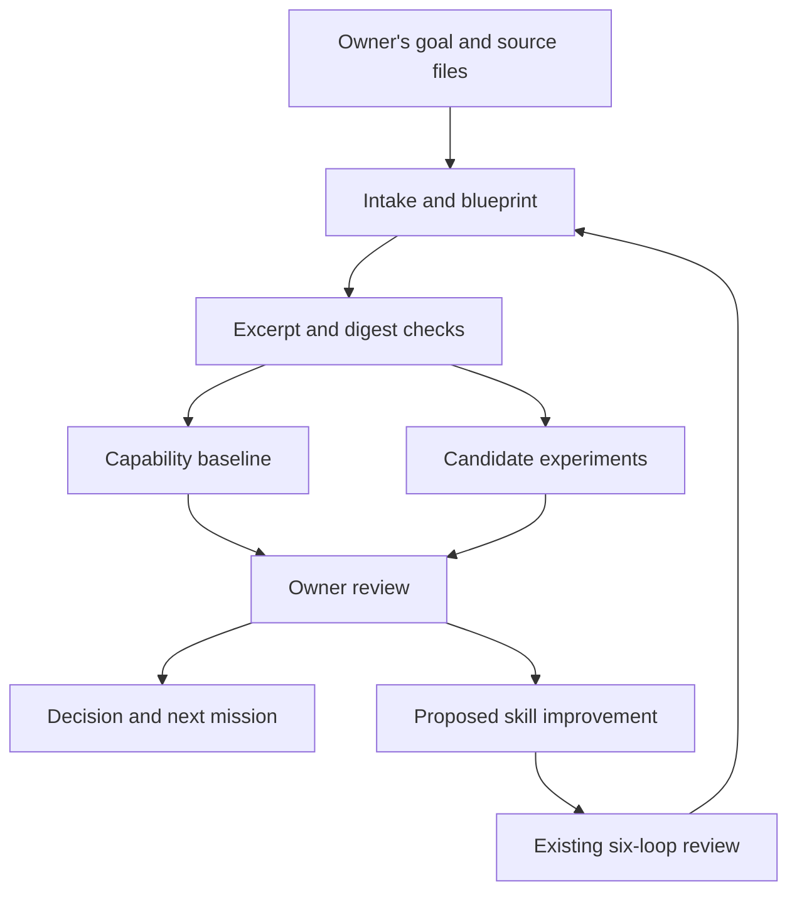

# Architecture · a decision with a return path

An activation is a local transaction. A declared audience selects a versioned blueprint. Evidence enters only through named files in the intake. The runner constructs all outputs before committing the generated directory. Human approval of that write does not confer authority to purchase, publish, train a model or change a shared workflow.

| Architectural layer | Contract in this release | Source of authority |
| --- | --- | --- |
| Human judgment | Goal, candidates, ownership, contradictory observations, signed decision | Operator and relevant rights holders |
| Agent expertise | Local skill discovery, bounded mission, explicit role | Blueprint, locked skill source and existing agent roles |
| Persistent context | Private source bundle, digests, decision and transferable replay input | Local workspace owner; upstream Memory and Capture remain optional |
| Model and compute | Deterministic local baseline records zero inference calls; model-backed work requires a separately authorized runtime and budget | Operator's provider account and terms |
| Execution | One runner selects any of four profiles, evaluates local inputs and produces artifacts | Versioned scripts, schemas and dependency registry |
| Governance | Dry-run, local apply, retained contradictions and pending human sign-off | Existing trust tiers, data boundaries and named reviewers |
| Commercial intelligence | Source-linked candidate experiments, explicit evidence for and against, inquiries classified separately from checkout | Customer evidence and existing merchant |
| Continuous evolution | New evidence, replay, recorded human learning and a proposed workflow change | Original six-loop operating model and independent reviewer |

The [registry](registry/capabilities.json) distinguishes a referenced implementation from a tested binding. Read downstream licensing and verification status before installing. A local export to a different runtime is a file handoff. Claude Code, ChatGPT, Gemini and OpenCode have no end-to-end compatibility claim for this activation release.

Each blueprint specializes one mission, operating role, starting template, evidence priorities and suggested skill set. Each uses the same input schema, maturity gates and output receipt. The generated runtime remains unbound until the operator deliberately installs/configures a host.

[Detailed upstream ownership and integration map](docs/portfolio-architecture.md) · [Original CoE design direction](https://github.com/Starlight-Intelligence/starlight-design-intelligence/blob/ac43168bb58587c4b92b84f05a8b2bab8e360df5/brand-packs/ai-coe/DESIGN.md)
