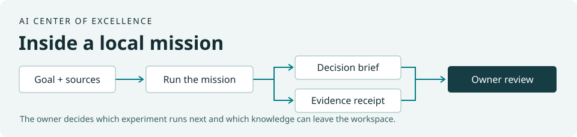

# Build and evolve your AI Center of Excellence

One operator can own the brief, the evidence, the tools and the decision. This repository gives that operator a working place to start. Bring a decision and a handful of observations. Leave with an inspectable brief, a capability baseline, a reproducible mission and a question worth answering on the next run.

[Run a founder mission](#activate-a-workspace) · [Read the architecture](ARCHITECTURE.md) · [Inspect a completed workspace](examples/founder/workspace) · [Teach an activation lab](curriculum/README.md)



## Activate a workspace

Requires Git and Python 3.10 or later. The core runner uses the Python standard library. From this checkout, run:

```bash
mkdir my-coe
python3 scripts/coe.py assess --input examples/founder/input.json
python3 scripts/coe.py activate --input examples/founder/input.json --workspace my-coe
python3 scripts/coe.py activate --input examples/founder/input.json --workspace my-coe --apply
cat my-coe/.ai-coe/decisions/first-mission.md
```

The activation command previews every output and the proposed decision. Adding `--apply` authorizes a local write, including private snapshots of the full evidence files you selected. An existing activation is preserved. The founder fixture is synthetic. It proposes a one-week handoff pilot, shows the contrary interview and leaves sign-off with the operator. The mission makes zero provider calls.

For your own run, copy [the intake and its evidence](examples/founder), replace the goal, owner, candidates, experiments and sources, and select your audience. Supply a file and an exact excerpt for each source. Review the complete files before applying. With an existing workspace, pass its directory directly. A suggested skill becomes discoverable in Codex after the [separate project-local installation](integrations/codex/README.md).

| Choose a blueprint | First decision | Evidence of value |
| --- | --- | --- |
| [Personal](blueprints/personal) | Which learning practice deserves a week? | An observed change in a real task |
| [Creator](blueprints/creator) | Which original brief goes into production? | A reviewable artifact, a rights record and an editorial decision |
| [Founder](blueprints/founder) | Which customer problem earns a validation experiment? | A counterexample, a test and an accountable owner |
| [Enterprise](blueprints/enterprise) | Which team pilot can operate within a named boundary? | Independent review and a decision about expansion |

## What the operator owns

The generated `.ai-coe/` directory contains the configuration, role, baseline, decision, evidence receipt, replayable source bundle, workflow and proposed improvement. Move it to another machine to inspect the records. Re-run its `replay/input.json` with this checkout and compare the receipts. A clean Git workspace ignores generated material by default. Export selected artifacts after review.

| I want to… | Start here |
| --- | --- |
| Inspect the decision rights and evidence checks | [Architecture](ARCHITECTURE.md) · [Security and data ownership](SECURITY.md) |
| Select a skill or infrastructure dependency | [Dependency inventory](registry/capabilities.json) · [Codex installation](integrations/codex/README.md) |
| Assess eleven capabilities without a vanity score | [Assessment method](assessments/README.md) |
| Develop someone else's ability to run the mission | [Curriculum and facilitator materials](curriculum/README.md) |
| Distinguish installable work, services and planned products | [Portfolio and offers](docs/portfolio-and-offers.md) · [Market comparison](docs/market-position.md) |
| Inspect validation and limitations | [Verification](docs/verification.md) · [Roadmap](ROADMAP.md) |

## Existing operating model components

```text
ai-coe/
  README.md
  AGENTS.md
  operating-model/            # the six loops: intake, design, build, review, deploy, monitor
    README.md                 # index + gate crosswalk table
    01-intake.md ... 06-monitor.md
    intake-form.md
    registry-fields.md
  governance/
    trust-tiers.md            # T0-T3 provenance scale, unifying MCP levels + CoE risk tiers
    mcp-trust-levels.md       # superseded for tier assignment, kept for level definitions
    ai-policy.md
    data-boundaries.md
  agents/                     # this CoE's own operating roles (chief-of-staff, research,
                               # builder, growth, governance) — not the ai-architect team
  templates/
    company-of-one/, creator-business/, ai-agency/, engineering-team/, university-lab/
    agent-cards/               # local copies; canonical source is starlight-agent-army-architecture
  vendor/ai-architect/         # vendored copies of the plugin's team + templates, drift-checked
  scripts/sync-check.mjs       # verifies vendor/ai-architect/ against the live plugin repo
  content/
    README.md
    ai-skills-and-ai-coe-ultimate-guide.md
    claude-skills-operating-layer-blog.md
  .claude-plugin/marketplace.json   # `/plugin marketplace add frankxai/ai-coe` finds ai-architect
```

## Existing operating model and architecture plugin

1. Read [`operating-model/README.md`](operating-model/README.md) for the six loops and how each
   maps to an `ai-architect` gate.
2. Read [`governance/trust-tiers.md`](governance/trust-tiers.md) before enabling autonomous
   execution — it is the one place MCP trust levels, CoE risk tiers, and the plugin's T0–T3
   provenance scale are reconciled.
3. Install the plugin this repo consumes:
   ```
   /plugin marketplace add frankxai/ai-coe
   /plugin install ai-architect@frankx-coe
   ```
   or `/plugin marketplace add frankxai/ai-architect` directly.
4. Run `node scripts/sync-check.mjs` after pulling to confirm `vendor/ai-architect/` still matches
   the plugin's live team and templates.
5. For this CoE's own operating roles (as opposed to the architecture-lifecycle team), see
   `agents/`. For the canonical agent-card format and roster, see
   [`starlight-agent-army-architecture`](https://github.com/frankxai/starlight-agent-army-architecture)
   — `templates/agent-cards/` here is a local mirror, not the source of truth.

## Publication-Ready Content

- [The Ultimate Guide to Building AI Skills and an AI Center of Excellence](content/ai-skills-and-ai-coe-ultimate-guide.md)
- [Claude Skills Are Not Just Prompts. They Are an Operating Layer for AI Teams.](content/claude-skills-operating-layer-blog.md)

## Design Principles

- **Governance before automation**
- **Clear trust boundaries for tools and data** — one scale, not three that drift apart
- **Skill-driven execution, gated by a plugin this repo consumes, not reimplements**
- **Observable weekly review loops**
- **Portable templates and examples**

[The rebellion is creation.](MANIFESTO.md)
