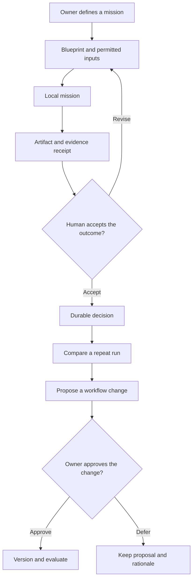

# Ownership and integration map

The CoE owns the decision to introduce, review, improve or retire a capability. Each upstream team owns its implementation. The existing six-loop operating model supplies the gates; four blueprint configurations supply different outcomes.

## Repository decision

| Candidate | Evidence | Decision |
| --- | --- | --- |
| AI-Architect-Studio/ai-coe | Existing company-of-one and team templates, governing roles, trust policy, vendor drift check, six-loop lifecycle | Extend the active repository. Keep historical links and operating roles intact. [Operating model at baseline](https://github.com/AI-Architect-Studio/ai-coe/blob/064826f3c6c9f662c6f3f9b364ff428b48efcd91/operating-model/README.md) |
| Starlight-Intelligence/ai-center-of-excellence | No exact repository found in the Starlight organization during the ownership check | A second canonical would divide issue ownership, review history and install guidance. |
| Starlight Intelligence System | Owns SIP v1.1.1, memory-provider interfaces, orchestration and inference bindings | Link pinned interfaces. Keep provider-specific implementation with the substrate. [SIP](https://github.com/Starlight-Intelligence/Starlight-Intelligence-System/blob/e159af3f94e93190c4a8ae127884d8f0d560dd5a/SIP.md) |
| AI Architect Academy | Existing coding-agent-native curriculum, governed by its own functional source license | Link labs under upstream terms. [License](https://github.com/frankxai/ai-architect-academy/blob/ba3ddce3905acdb00c25343c583b02150e559369/LICENSE) |
| AI CoE Content Creation | Publisher's editorial source and contract design with reserved rights | Refer publishing work to its rights owner. [Source](https://github.com/frankxai/ai-coe-content-creation/blob/c1c73267c36a8c82ba4ece090226aa38660e8042/README.md) |

## Capability boundaries

| Layer | Owner decision | Durable output | Optional upstream |
| --- | --- | --- | --- |
| Human judgment | Define the objective, acceptance evidence and owner | Falsifiable mission brief | Reality Architect method and Academy practice |
| Agent expertise | Select a bounded job and permitted inputs | Role, acceptance rule and failure case | Starlight Capability Foundry; AI Architect decision review |
| Context | Determine what may persist and who may recall it | Evidence pointers, digests and decision record | SIP; tenant-scoped gateway |
| Models and compute | Approve provider, budget, data boundary and access method | Call receipts and cost per accepted outcome | Starlight harness and gateway |
| Execution | Authorize only the actions the mission needs | Local artifacts or a draft for review | Starlight Factory, GenCreator skills, publishing studio |
| Governance | Apply the CoE's T0–T3 provenance and authority policy | Approval, scope, evaluation and reversal path | Local trust policy and independent technical review |
| Commerce | Select an experiment or draft from evidence and an owned catalogue | Validation brief or unapproved quote | Agentic Income quote desk |
| Learning | Compare operator and agent performance on a second mission | Proposed skill change with reviewer and comparison | Academy plugin, Knowledge Tree, evaluation lanes |

Each external dependency has a public repository, immutable source revision, exact file blob, purpose, license evidence, dependencies and validation mode in the [capability registry](../registry/capabilities.json). The [schema](../schemas/capabilities.schema.json) defines the machine-readable contract. The registry distinguishes upstream source inspections from integration runs. Source inspection establishes that a contract or implementation exists; it does not establish host discovery, runtime availability or a commercial entitlement.

### From an observation to an improved capability



A first mission can demonstrate local execution and generate a learning proposal. A human must review the outcome, and a second measured run must support any claim that performance improved.

### Scale without a second control plane

- **Personal** keeps evidence and goals under the operator's local ownership. Shared memory requires a deliberate export.
- **Creator** sends a rights-cleared brief to a production skill. Drafts and distribution permissions have separate owners. Arcanea original worlds retain their own rights.
- **Founder** starts with a customer problem. A proposal to test demand can later become a quote draft against a real catalogue after owner review.
- **Enterprise** gives the reviewer and workflow owner separate responsibilities. An organization must supply identity, access enforcement, retention policy and procurement before connecting managed systems.

### Integration policy

Local activation requires no provider subscription. An optional remote run needs an authorized provider access method, an explicit ceiling, a data boundary and an owner for the resulting bill. Report calls, priced units and accepted outcomes separately. A zero-call local run has zero model charges. It does not estimate labor, hosting, subscription allocation or the value of the outcome.

Memory, Capture and recall services keep their own access boundaries. A local mission can consume an approved UTF-8 export and preserve its evidence hash. Binding a live capture device, memory service or enterprise connector requires a separate integration test. The public registry contains no private endpoints, internal repository paths, source contents or credentials.

The visual brief follows the existing AI CoE / Academy design pack. Reuse an image or wordmark only under its own grant. First-party methodology, third-party source snapshots and illustrative brand assets can have different terms in the same repository. [CoE design pack](https://github.com/Starlight-Intelligence/starlight-design-intelligence/blob/ac43168bb58587c4b92b84f05a8b2bab8e360df5/brand-packs/ai-coe/BRAND.md) · [Upstream notices](https://github.com/Starlight-Intelligence/starlight-design-intelligence/blob/ac43168bb58587c4b92b84f05a8b2bab8e360df5/THIRD_PARTY_NOTICES.md)

## Reproduced optional handoffs

Two pinned upstreams were executed independently of a paid provider. This optional probe checks existing implementations in their own checkouts. It reads the pins from the registry and refuses a mismatched commit or dirty worktree. The built-in activation does not fetch upstream code. Run from the CoE repository root with Git, Python 3.11+ and Node.js 20+ with npm.

```bash
work=$(mktemp -d)
git clone https://github.com/frankxai/agentic-income-skills "$work/quote"
git -C "$work/quote" checkout --detach d0346f9392772ec5d2a32d33456831c34640dd95
git clone https://github.com/Starlight-Intelligence/starlight-ai-harness "$work/harness"
git -C "$work/harness" checkout --detach bb6b9ce8423a9a60b95ae636253d05c8011c97d9
python3 integrations/upstream/check.py --quote "$work/quote" --harness "$work/harness"
```

Observed on Linux, November 25, 2026, with Python 3.12.14, Node 24.22.3 and npm 11.19.1. A synthetic request for one inspection produced a **EUR 120.00 draft** under the upstream sample catalogue. Outbound delivery stayed disabled, second intake preserved the record, and human approval remained required. The independent harness self-test passed 22 deterministic checkers. Both probes used zero model calls. The harness run tested checkers against ground truth; it measured no provider's quality. The quote fixture establishes no sale, earning or payment availability.

```json
{
  "harness": "selftest OK: all 22 checkers pass ground truth, html-design rejects slop",
  "synthetic_quote_id": "07b8ba832485411b99af70bac9894a68e09c14e398a14e0d2ae1d13350e377c7",
  "draft_subtotal_eur": "120.00",
  "human_approval_required": true,
  "outbound": "disabled",
  "duplicate_preserved": true,
  "model_calls": 0
}
```
